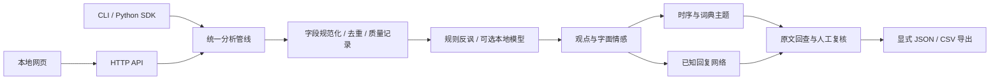

# 架构与局限

核心包命名为 `douyin_engine`，自带网页和合成数据资源，源码运行及安装后的使用不依赖原工作目录。默认模式只使用 Python 标准库。反讽模型模块延迟加载重型依赖；缺少权重不会阻止规则模式启动。

观点抽取、词典情感、主题和变化提示属于可解释基线。未知对象、隐式指代、跨句依赖、否定或讽刺语境可能被误读。反讽不直接改变情感，避免把二分类结果当作语义反转依据。

时间聚合使用 Asia/Shanghai；缺少时区数据库的平台会明确采用 UTC+08:00 固定偏移，不声称完整历史夏令时支持。没有时间的行不进入时序；长间隔以空桶或显式缺口表示，不制造连续趋势。

网络只使用样本中真实提供、可对应作者的回复边，方向为回复者指向被回复者。PageRank 和综合评分只是样本内可见互动统计，受缺失、采样及时间影响，不表示真实社会影响或操纵证据。

人工标签与备注存于浏览器内存，导出时添加独立字段，原始机器标签保持不变。页面刷新会丢失未导出的工作；应用不提供持久化标注数据库。

本地分析不调用远端模型。可选采集命令会在用户明确调用时访问白名单公开页面，应与离线分析区分。没有公网部署、账号权限、视频/音频理解、全平台覆盖或真实场景准确率承诺。
